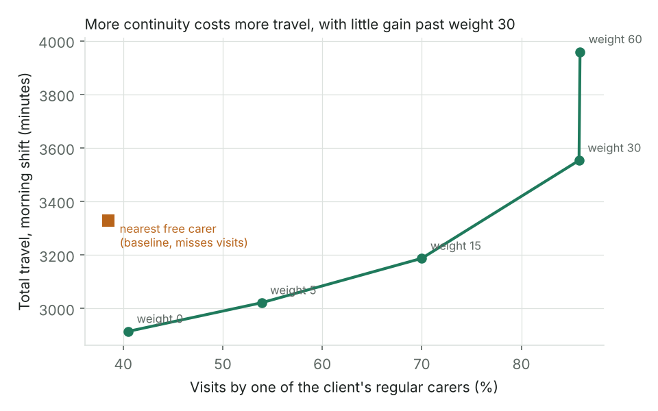
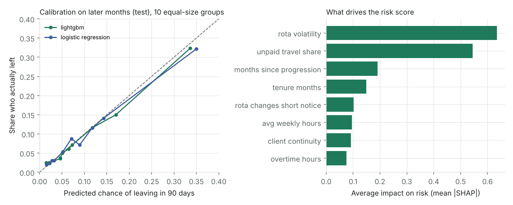

# CarePulse

**An AI operations prototype for home-care providers.** It plans which carer
goes to which visit, spots staff who may be about to leave, and reads visit
notes for safeguarding and other concerns, with a person always in charge
of the decisions that matter.

Everything runs on **synthetic data**. No real clients, staff or notes are used.



## What it does

| Part | The problem | What CarePulse does |
|---|---|---|
| **Visit matching** | Rotas built by hand waste travel time, miss visits, and send clients a different face every day | Assigns visits to carers with Google OR-Tools. Skills, carer-gender preferences, time windows and shifts are never broken. Travel, continuity, workload balance and punctuality are traded off with weights a manager can see and change |
| **Retention risk** | Care has high staff turnover, and leavers often give warning signs in their rota first | Predicts the chance each carer leaves in the next 90 days, explains why in plain words, and suggests a supportive action. Sex and age are not used as inputs |
| **Care-notes checks** | Concerns can sit unread in hundreds of free-text notes | Removes names and contact details, finds safeguarding, missed-task, deterioration and quality concerns, quotes the evidence, and routes each note: urgent review, review, record or no action |

## Results (synthetic data)

All numbers come from `python scripts/run_all.py`. Full tables are in
[reports/RESULTS.md](reports/RESULTS.md).

**Visit matching:** 45 carers, about 268 morning visits, averaged over 5 days.

| | Nearest free carer (baseline) | Optimised |
|---|---|---|
| Visits covered | 251 of 268 | **265 of 268** |
| Travel per visit | 12.5 min | **12.3 min** |
| Visits by a regular carer | 32% | **69%** |
| Started within 15 minutes of plan | 29% | **71%** |
| Most visits for one carer | 8.6 | **7.8** |

A second baseline that always tries a regular carer first reaches 77%
continuity, but needs 16 minutes of travel per visit and still misses
17 visits. The chart above shows the trade-off: raising the continuity
weight from 0 to 30 lifts continuity from 41% to 86% for 22% more travel,
and gains almost nothing after that.

**Retention risk:** trained on months 0 to 11, tested on months 18 to 21
(with gaps so labels cannot leak between periods).

| | Result |
|---|---|
| ROC AUC | 0.76 |
| Leavers caught in the top 10% of scores | 36% (3.6 times what random picking would catch) |
| Precision in the top 10% | 33%, against a 9% base leave rate |
| Calibration error | 0.007 (a 30% score means about 3 in 10 leave) |

A simple logistic regression scored almost the same as LightGBM (AUC 0.757
vs 0.756), which is worth knowing: the simpler model would be easier to
explain to staff. The fairness check found the model under-predicts risk
for carers aged 55+ (9.6% predicted vs 11.8% actual) and catches fewer
leavers aged 40 to 54 (39% vs 45 to 50% for other groups). Both would need
watching on real data.



**Care-notes checks:** 2,110 training notes and 890 test notes. Test notes
use sentence patterns never seen in training.

| Detector | Safeguarding recall | Notes sent to a person that had no concern |
|---|---|---|
| Rules (default) | 97.8% | 0.2% |
| Rules + learned word-based classifier | 100% | 32% |

Two honest caveats:

1. **The rules were written by someone who knew how the notes were
   generated**, so their near-perfect scores show the logic works, not how
   it will do on real notes.
2. **The learned classifier generalises badly to new phrasings** (it found
   only 14% of deterioration cases it had not seen worded that way before).
   This is the argument for a language model: it understands meaning, not
   just matching words. The LLM backend is built and tested with mocks; run
   `make llm-eval` with Ollama to measure it on the same test set.

Redaction removed every client name and phone number in the test set.

## How the AI is kept safe

- **A person decides.** Every possible safeguarding concern goes to urgent
  review. The system can never close one on its own.
- **Evidence or nothing.** Each finding must quote words that really appear
  in the note. LLM answers that fail this check are dropped and logged.
- **Fail safe.** If a model errors or gives bad output, the note goes to a
  person instead of being marked "no action".
- **Data minimisation.** Names, phone numbers, NHS numbers, emails and
  postcodes are removed before any model reads a note. The LLM runs locally.
- **Role-based access.** Coordinators plan and check notes; only managers
  see retention scores and make review decisions; auditors can verify the log.
- **Tamper-evident audit log.** Each entry carries the hash of the one before.

More in [docs/data-protection.md](docs/data-protection.md) and
[docs/risk-register.md](docs/risk-register.md).

## Run it

```bash
pip install -r requirements.txt
make test          # 29 tests
make results       # every experiment, about 4 minutes
make serve         # API and dashboard at http://localhost:8000 (key: demo-manager)
```

Optional, on a machine with internet access and Ollama:

```bash
make roads         # download Birmingham's real road network from OpenStreetMap
ollama pull llama3.1:8b
make llm-eval      # score the local LLM on the held-out notes
CAREPULSE_LLM=llama3.1:8b make serve   # use the LLM in the dashboard
```

**About travel times:** the published results used an estimate (straight-line
distance times 1.35, at 24 km/h, plus 3 minutes to park), because road data
could not be downloaded where they were produced. After `make roads`, the
same code uses real drive times on the OpenStreetMap network, and every
report states which one it used.

## Project layout

```
carepulse/
  data/        synthetic carers, clients, visits, staff history and notes
  geo/         travel times (OpenStreetMap roads or estimate)
  matching/    OR-Tools matching engine, baselines, rule checker
  retention/   attrition model, calibration, SHAP reasons, fairness checks
  notes/       redaction, rules, classifier, local LLM, routing
  common/      audit log
  api/         FastAPI service with role-based keys
dashboard/     single-page dashboard with a Leaflet map
scripts/       run_all.py (all experiments), eval_llm.py
docs/          architecture, user guide, model cards, data protection, risk register
reports/       generated results and charts
```

## Documents

- [Architecture](docs/architecture.md)
- [User guide for coordinators and managers](docs/user-guide.md)
- [Model cards](docs/model-cards.md)
- [Data protection notes](docs/data-protection.md)
- [Risk register](docs/risk-register.md)

## Limits

This is a prototype built to show the approach. Before real use it would
need real data, results re-measured on that data, a Data Protection Impact
Assessment, single sign-on, and testing with the coordinators and managers
who would use it. Double-up visits (two carers at once) and evening shifts
are not modelled yet.

Licence: MIT. Author: Jasper Chinedu Nwangere.
