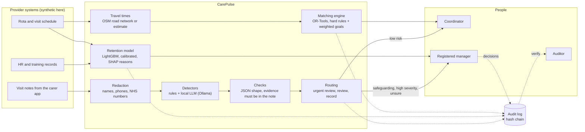

# Architecture

CarePulse is split into small parts that each do one job, so any part can be
swapped later (for example, a different LLM or a different routing engine)
without rewriting the rest.

## Parts

| Part | Code | What it does |
|---|---|---|
| Synthetic data | `carepulse/data/` | Carers, clients, visits, 24 months of staff history, and labelled visit notes. No real people. |
| Travel times | `carepulse/geo/travel.py` | Drive times from the OpenStreetMap road network, or an estimate when road data is not available. |
| Matching | `carepulse/matching/engine.py` | Assigns visits to carers. Hard rules always hold; travel, continuity, workload balance and punctuality are traded off with visible weights. |
| Retention | `carepulse/retention/model.py` | Chance each carer leaves in the next 90 days, with reasons and a supportive action. |
| Care notes | `carepulse/notes/` | Removes identifiers, finds concerns, checks every finding quotes the note, and routes it. |
| Audit | `carepulse/common/audit.py` | Append-only log where each entry includes the hash of the one before. |
| API | `carepulse/api/app.py` | FastAPI service with role-based API keys and input limits. |
| Dashboard | `dashboard/index.html` | One page for coordinators and managers: map of runs, risk list, note checker, review queue. |

## How it would connect to PBL's systems

The prototype reads its own synthetic data. In the real project each source
would sit behind a small adapter (for example, a nightly export or an API
from the rota system), mapped into the same tables. The matching engine
would write a draft rota back for a coordinator to approve, never publish it
on its own.
