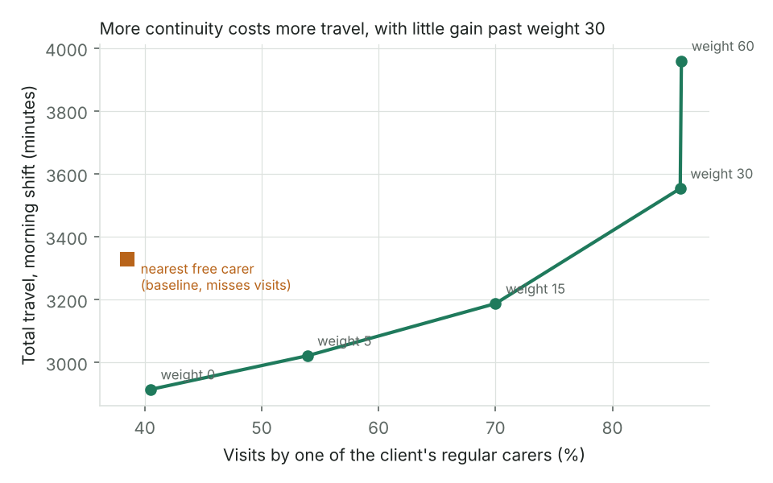
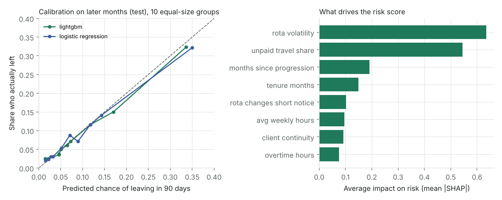

# Results

Generated by `scripts/run_all.py` on synthetic data. Re-run it to reproduce every number.

## 1. Visit matching

Travel times: **estimated (straight line x 1.35 at 24 km/h)**. 45 carers, about 269 visits per morning shift, averaged over 5 days. Solver time limit 20 s.

| Plan | Visits covered | Not covered | Travel (min) | Travel per visit | Regular carer % | Within 15 min % | Most visits, one carer |
|---|---|---|---|---|---|---|---|
| nearest free carer | 251.4 | 16.2 | 3138.2 | 12.5 | 32.3 | 29.0 | 8.6 |
| regular carer first | 250.8 | 16.8 | 4007.6 | 16.0 | 76.9 | 31.5 | 8.4 |
| optimised | 265.4 | 2.2 | 3265.0 | 12.3 | 69.4 | 71.1 | 7.8 |




| Continuity weight | Travel (min) | Regular carer % | Within 15 min % |
|---|---|---|---|
| 0 | 2914 | 40.5 | 76.6 |
| 5 | 3021 | 53.9 | 74.7 |
| 15 | 3187 | 70.0 | 74.2 |
| 30 | 3553 | 85.8 | 68.7 |
| 60 | 3959 | 85.9 | 59.5 |


## 2. Retention risk

Train on months 0 to 11, calibrate on 14 to 15, test on 18 to 21 (gaps stop label leakage). 5600 test snapshots.

| Model | ROC AUC | PR AUC | Brier | Calibration error | Leave rate | Precision in top 10% | Leavers caught in top 10% |
|---|---|---|---|---|---|---|---|
| logistic regression | 0.757 | 0.282 | 0.0724 | 0.0078 | 0.089 | 0.316 | 0.353 |
| lightgbm | 0.756 | 0.287 | 0.0719 | 0.0074 | 0.089 | 0.325 | 0.363 |


Fairness at the top-10% flag line (sex and age are not model inputs):

| Attribute | Group | n | Actual leave rate | Mean predicted | ROC AUC | Flag rate | Leavers caught |
|---|---|---|---|---|---|---|---|
| sex | F | 4472 | 0.087 | 0.094 | 0.763 | 0.142 | 0.455 |
| sex | M | 1128 | 0.099 | 0.094 | 0.728 | 0.134 | 0.438 |
| age_band | 18-24 | 1031 | 0.089 | 0.092 | 0.777 | 0.126 | 0.5 |
| age_band | 25-39 | 2087 | 0.085 | 0.092 | 0.77 | 0.141 | 0.452 |
| age_band | 40-54 | 1649 | 0.081 | 0.097 | 0.724 | 0.144 | 0.388 |
| age_band | 55+ | 833 | 0.118 | 0.096 | 0.755 | 0.148 | 0.49 |





## 3. Care notes

2110 training notes, 890 test notes. Test notes use sentence families never seen in training.


**Rules (default pipeline).** Written with knowledge of the note generator, so read these as a check that the logic works, not as real-world accuracy.

| category | positives | precision | recall | f1 |
|---|---|---|---|---|
| safeguarding | 139 | 0.986 | 0.978 | 0.982 |
| missed_task | 122 | 1.0 | 1.0 | 1.0 |
| deterioration | 130 | 1.0 | 1.0 | 1.0 |
| quality_risk | 117 | 1.0 | 0.991 | 0.996 |


**Learned classifier (TF-IDF + logistic regression), on unseen phrasings.**

| category | positives | precision | recall | f1 |
|---|---|---|---|---|
| safeguarding | 139 | 0.385 | 0.986 | 0.554 |
| missed_task | 122 | 0.44 | 0.574 | 0.498 |
| deterioration | 130 | 0.305 | 0.138 | 0.19 |
| quality_risk | 117 | 0.202 | 0.846 | 0.326 |


Thresholds tuned on held-out training families: `{'safeguarding': 0.2, 'missed_task': 0.23, 'deterioration': 0.71, 'quality_risk': 0.16}` (safeguarding tuned for at least 95% recall).


**Routing with rules only:**

```
{
  "share_by_route": {
    "no_action": 0.502,
    "record": 0.273,
    "urgent_review": 0.155,
    "review": 0.07
  },
  "safeguarding_notes_sent_to_urgent_review": 0.978,
  "notes_with_a_concern_seen_by_a_person_or_recorded": 0.991,
  "routine_notes_sent_to_a_person": 0.002
}
```


**Routing with rules plus classifier:**

```
{
  "share_by_route": {
    "urgent_review": 0.39,
    "no_action": 0.234,
    "record": 0.201,
    "review": 0.175
  },
  "safeguarding_notes_sent_to_urgent_review": 1.0,
  "notes_with_a_concern_seen_by_a_person_or_recorded": 1.0,
  "routine_notes_sent_to_a_person": 0.322
}
```


**Redaction:** `{"notes_with_phone": 35, "phones_left_after_redaction": 0, "client_names_left": 0}`
